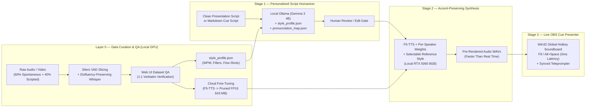

# Natural Presenter AI

[](https://www.python.org/)
[](https://pytorch.org/)
[](https://github.com/SWivid/F5-TTS)
[](https://ollama.com/)
[](LICENSE)

**A 100% local, privacy-first, multi-accent AI voice presentation studio** built by **Thai Binh Nguyen** and **Ege Deniz**.

Unlike commercial TTS APIs that flatten international speakers into generic, overly polished American/British radio voices, **Natural Presenter AI** preserves each speaker's **authentic non-native English accent** (e.g., Vietnamese, Turkish, Cypriot, Hungarian, Spanish), personal speaking pace, breaths, and **individualized hesitation patterns** (`uh`, `um`, `like`, `eh`, subtle self-repairs) — paired with a **zero-latency human-driven live OBS Cue Soundboard** for recording smooth technical demos across code and reports.

> 🎥 **Demo Video & Interactive Audio Showcase:** *(Add your 60–90s demo video & Hugging Face Spaces link here once recorded — see [`hf_space/`](hf_space/) for the ready-to-deploy free CPU showcase!)*

---

## Why We Built This (3 Real-World Problems Solved)

1. **Over-Polished "Uncanny" TTS:** Commercial TTS models normalize pronunciation through US/UK phonetic dictionaries (G2P) and strip out breaths and hesitations, immediately sounding synthetic during technical presentations.
2. **One-Size-Fits-All Disfluencies Don't Work:** Even speakers from the same region hesitate completely differently (in our real data, Speaker 1 speaks at `102.7 WPM` using `uh 78% / like 13%`, while Speaker 2 speaks at `146.6 WPM` using `uh 79% / eh 12% / um 9%`). Every speaker gets an automatically extracted `style_profile.json` and isolated voice weights.
3. **Computer-Use Vision Agents Are Too Slow for Live Screen Recording:** Autonomous mouse-moving agents take 2–5 seconds per action and move jerkily across code/PDFs. Instead, our **Human-in-the-Loop Cue Presenter (`ADR-006`)** lets the human smoothly move the cursor, scroll, and switch windows on clean deliverables while triggering **0ms pre-rendered multi-speaker AI voice cues** via global Windows hotkeys (`F9` / `Alt+Space` / Mouse Side Button).

---

## System Architecture



---

## Verified Engineering Results & Benchmarks

| Metric | Result | Notes |
| :--- | :--- | :--- |
| **Verified Curated Dataset (`vn_01`)** | **173 clips / 26.65 min** | Balanced 51.5% Spontaneous Part A + 48.5% Scripted Part B; iPhone 16 Lossless ALAC at **34.7–42.6 dB SNR**, 0% clipping |
| **Fine-Tuning Convergence (`FT-001`)** | **60 epochs / 4,020 updates**, final loss `0.408` | `F5TTS_v1_Base`, `fp16` + 8-bit AdamW (`bnb_optimizer`), `lr=1e-5`, `warmup=100` on single Tesla T4 (15GB) |
| **Model Compression (EMA FP16 Pruning)** | **3.38 GB → 643 MB (5.2× smaller)** | Strips training optimizer state for lightweight local inference (`safetensors`) |
| **Local Inference Speed (RTX 5060 8GB)** | **5.3s for 6.5s audio** (faster than real time) | 16 ODE steps (`Fast Preview`), single-pass batching, 100% offline |
| **Subjective Voice & Pacing Quality** | **7–8/10** (Zero-Shot) → **9.5–10/10** (Fine-Tuned) | Authentic Vietnamese-English accent, breaths, `uh/like` cadence, and `MSE` → `M S E` acronym accuracy |
| **Live Recording Trigger Latency** | **0 ms** (pre-rendered cue WAVs) | Native Win32 `GetAsyncKeyState` works across PDF, JupyterLab, and OBS with synced `NOW SPEAKING` teleprompter |

---

## Key Features (4-Tab Local Web Studio)

1. **Presentation Studio:** Select speaker (`vn_01`, `vn_02`, …), **Reference Style** (`partA_natural_slow_ref`, `partB_studio_clear_ref`, …), hesitation intensity (`None / Low / Medium / High`), subtle self-repairs toggle, and slide/paragraph pause duration.
2. **Dataset QA Reviewer:** Live verified progress tracker, default `Only Unverified (TODO)` filter, 1-click `✅ Verify & Next`, `Save Clip as Reference Style`, and 1-click `Rebuild style_profile.json`.
3. **Pronunciation Dictionary (`config/pronunciation_map.json`):** Editable technical lexicon (60+ preloaded ML/engineering terms like `MSE → M S E`, `CNN → C N N`, `ReLU → ray-loo`, `CUDA → kooda`) enforced in both Stage 1 and Stage 2.
4. **Cue Presenter (Live OBS):** Import a multi-speaker **Markdown Cue Script** (see [`docs/CUE_SCRIPT_TEMPLATE.md`](docs/CUE_SCRIPT_TEMPLATE.md)) or annotated PDF/Jupyter files → batch humanize & pre-render → arm global hotkeys (`F9` / `Alt+Space` = Play, `F8` / `Alt+R` = Replay, `F10` / `Alt+S` = Stop) for seamless single-take OBS recording.

---

## Quick Start (Local Installation)

```powershell
# 1. Clone repository
git clone https://github.com/nguyenthaibinh19/natural-presenter-ai.git
cd natural-presenter-ai

# 2. Create Conda environment (Python 3.11 + FFmpeg)
conda create -n presenter-ai python=3.11 ffmpeg -c conda-forge -y
conda activate presenter-ai

# 3. Install PyTorch with CUDA (CUDA 12.8+ required for RTX 50-series Blackwell)
pip install torch torchaudio --index-url https://download.pytorch.org/whl/cu128

# 4. Install dependencies
pip install -r requirements.txt

# 5. (Recommended) Install local Ollama + Gemma 3 4B for free offline Stage 1
winget install Ollama.Ollama
ollama pull gemma3:4b
copy .env.example .env

# 6. Launch on Windows interactive desktop (enables global hotkeys)
start_presenter.bat
```

---

## Repository Structure

```text
natural-presenter-ai/
├── README.md
├── LICENSE
├── AGENTS.md                         # Auto-read rules & reading order for AI coding agents
├── start_presenter.bat               # Portable Windows launcher (real Default desktop for hotkeys)
├── requirements.txt
├── .env.example
├── config/
│   └── pronunciation_map.json        # Editable technical acronym/pronunciation lexicon
├── src/
│   ├── schemas.py                    # Pydantic v2 contracts for clips, profiles, and cue decks
│   ├── humanizer.py                  # Stage 1: Ollama/Gemma long-form humanizer + self-repairs
│   ├── synthesizer.py                # Stage 2: F5-TTS synthesizer + Reference Style + pauses
│   └── cue_presenter.py              # Stage 3: Markdown/PDF/ipynb cue parser + Win32 hotkey player
├── scripts/
│   ├── 00_extract_diarize_video.py   # Offline FFmpeg + Silero VAD + SpeechBrain speaker separation
│   ├── 01_preprocess_audio.py        # 24kHz mono WAV normalization + Silero VAD slicing (--append)
│   ├── 02_transcribe_align.py        # Disfluency-preserving faster-whisper + pause detection (--append)
│   ├── 03_build_dataset_labels.py    # Clean-text pairing & tone labeling
│   ├── 04_extract_style_profile.py   # Extracts WPM, filler distribution & few-shot examples
│   ├── 05_train_cloud.py             # F5-TTS fine-tuning dataset exporter & CLI wrapper
│   ├── 06_export_humanizer_sft.py    # Exports ChatML JSONL for optional Stage 1 Gemma QLoRA
│   └── 07_generate_showcase_samples.py # Generates neutral audio showcase clips for Hugging Face Spaces
├── notebooks/
│   ├── 05_finetune_f5tts_colab.ipynb       # Google Colab Pro (T4/L4) fine-tuning + FP16 pruning
│   └── 05_finetune_f5tts_jupyter_l40.ipynb # Linux JupyterLab (NVIDIA L40) fine-tuning notebook
├── app/
│   └── web_ui.py                     # 4-tab local Gradio studio
├── hf_space/                         # Free CPU-only Hugging Face Spaces portfolio showcase
├── docs/                             # Human guides, AI agent spec, recording & cue templates
└── .ai/                              # Durable project memory (ADRs 001–006, invariants, experiments, lessons)
```

---

## Documentation & Engineering Memory

- **[.ai/README.md](.ai/README.md)** — Durable engineering memory: [`current_state.md`](.ai/current_state.md), [`architecture.md`](.ai/architecture.md), [`invariants.md`](.ai/invariants.md), [`experiments.md`](.ai/experiments.md), [`lessons.md`](.ai/lessons.md), and **Architecture Decision Records [`ADR-001`–`ADR-006`](.ai/decisions/)**.
- **[docs/PROJECT_GUIDE.md](docs/PROJECT_GUIDE.md)** — End-to-end product & engineering overview.
- **[docs/AI_AGENT_SPEC.md](docs/AI_AGENT_SPEC.md)** — Single-file technical specification & JSON schemas.
- **[docs/RECORDING_GUIDE.md](docs/RECORDING_GUIDE.md)** — 60/40 recording guide + 18 presentation scripts.
- **[docs/CUE_SCRIPT_TEMPLATE.md](docs/CUE_SCRIPT_TEMPLATE.md)** — Copy-paste ChatGPT prompt & Markdown Cue Script template.

---

## Responsible AI, Privacy & Voice Consent

- **Strict Consent Policy:** This repository is built exclusively for **self-cloning or explicitly consented team voice profiles** (such as delivering your own technical presentations or educational walkthroughs). Do not use this tool to impersonate any person without explicit informed consent.
- **No Voice Data or Weights Distributed:** All raw audio recordings (`profiles/`), trained voice weights (`*.safetensors`, `*.pt`), and private presentations (`presentations/`) are excluded via `.gitignore` and never committed to GitHub.
- **Local-First & GDPR-Friendly:** Both Stage 1 (Ollama Gemma 3) and Stage 2 (F5-TTS) run 100% locally offline so private voice biometrics and internal presentation scripts never leave the user's machine.
